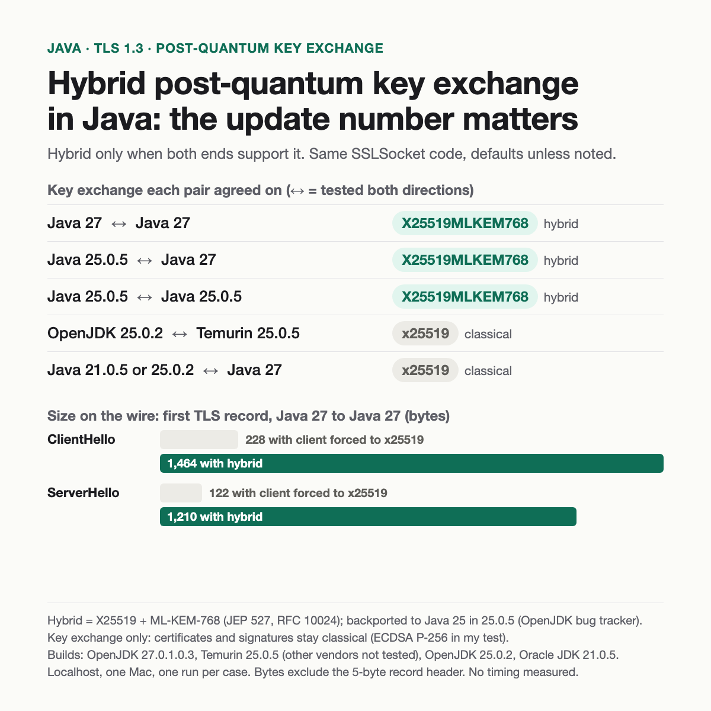

# Post-quantum hybrid key exchange in Java's TLS: does your JDK actually negotiate it?

A small, reproducible localhost test of hybrid post-quantum key exchange in the JDK's built-in TLS 1.3 ([JEP 527](https://openjdk.org/jeps/527)), across four JDK builds. The hybrid group is `X25519MLKEM768`: classical X25519 plus ML-KEM-768 (NIST FIPS 203), defined in [RFC 10024](https://www.rfc-editor.org/rfc/rfc10024.html).

Builds tested: OpenJDK 27.0.1.0.3, Eclipse Temurin 25.0.5+8, OpenJDK 25.0.2, Oracle JDK 21.0.5 (exact versions in each `env.txt`). It accompanies this LinkedIn post: https://www.linkedin.com/feed/update/urn:li:activity:7520078511999623168/



## Results

Plain `SSLSocket` code with nothing post-quantum specific in it; default settings unless noted. Full tables, `env.txt` and raw logs are in [`results/`](results/).

| client ↔ server (both directions tested) | key exchange agreed |
|---|---|
| Java 27 ↔ Java 27 | `X25519MLKEM768` (hybrid) |
| Temurin 25.0.5 ↔ Java 27 | `X25519MLKEM768` (hybrid) |
| Temurin 25.0.5 ↔ Temurin 25.0.5 | `X25519MLKEM768` (hybrid) |
| OpenJDK 25.0.2 ↔ Temurin 25.0.5 | `x25519` (classical) |
| Oracle JDK 21.0.5 or OpenJDK 25.0.2 ↔ Java 27 | `x25519` (classical) |

- **Mixed pairs still connect.** A peer without hybrid support just gets classical `x25519`, and the handshake succeeds.
- **Hybrid-only locks out clients without hybrid support.** A Java 27 server limited to `X25519MLKEM768` (via `-Djdk.tls.namedGroups`) accepted the 25.0.5 client but rejected the 21.0.5 and 25.0.2 clients; the server log says `No common named group`, while the client only saw `Received fatal alert: unexpected_message`.
- **Size on the wire** (Java 27 ↔ Java 27, first TLS record, 5-byte record header excluded): ClientHello 228 bytes with the client forced to `x25519` vs 1,464 with hybrid; ServerHello 122 vs 1,210. [RFC 10024](https://www.rfc-editor.org/rfc/rfc10024.html) gives the `X25519MLKEM768` key shares as 1,216 bytes (client) and 1,120 bytes (server).

## How to tell which key exchange you got

- `SSLSession.getCipherSuite()` returned `TLS_AES_256_GCM_SHA384` for both the hybrid and the classical handshake. In TLS 1.3 the cipher suite doesn't name the key-exchange group; that's negotiated separately ([RFC 8446](https://www.rfc-editor.org/rfc/rfc8446.html) §4.1.1).
- `SSLParameters.getNamedGroups()` returns your side's configured list, not what was agreed.
- The handshake debug log does show it: run with `-Djavax.net.debug=ssl:handshake` and look for `"server_share"` → `"named group"`. It's a debug log, not an API: the JSSE Reference Guide says the output is non-standard and may change between releases. These tests only used it on localhost.

## What keeps the key exchange classical

- **A peer without support** (e.g. Oracle JDK 21.0.5 or OpenJDK 25.0.2 in these tests).
- **Pinned named groups:** if `jdk.tls.namedGroups` or `SSLParameters.setNamedGroups` leaves out `X25519MLKEM768`, there's no hybrid, even on Java 27.
- **TLS handled somewhere else:** the JDK's built-in TLS (`javax.net.ssl`) only picks the key exchange for connections it handles. If a load balancer, proxy or sidecar terminates TLS, or your app uses a different TLS library, that's what negotiates the connection (not tested here).
- **TLS 1.2:** JEP 527 covers TLS 1.3 only.

Only the key exchange changes. Certificates and handshake signatures stay classical (the test certificate here is EC P-256).

## Which Java builds have it

- **Java 27:** JEP 527, delivered in JDK 27 (GA 15 Sep 2026). `X25519MLKEM768` is first in the default named groups; `SecP256r1MLKEM768` and `SecP384r1MLKEM1024` exist but are off by default.
- **Java 25:** backported in the 25.0.5 update (20 Oct 2026), per the OpenJDK bug tracker ([JDK-8387671](https://bugs.openjdk.org/browse/JDK-8387671), a backport of [JDK-8314323](https://bugs.openjdk.org/browse/JDK-8314323)). Tested here with Eclipse Temurin 25.0.5; other vendors' 25.0.5 builds were not tested. Note that this repo's 25.0.2 is OpenJDK and its 25.0.5 is Temurin, so the test alone doesn't separate update from vendor; the bug tracker is what places the change in 25.0.5.
- **Java 21:** as of 2026-10-25, the OpenJDK bug tracker lists the backport only for an Oracle JDK 21 update planned for January 2027. The Oracle JDK 21.0.5 tested here doesn't have it.

## Run it yourself

Needs JDK 21+ to run the files; hybrid needs JDK 27 or a backport such as 25.0.5 on both ends. No build step: each `.java` file runs as a single source file.

```bash
./run-matrix.sh /path/to/jdk-27/Contents/Home /path/to/older-jdk/Contents/Home
```

On macOS you can pass `"$(/usr/libexec/java_home -v 27)"` and `"$(/usr/libexec/java_home -v 21)"`. Each run writes `results/<date>-pq-tls-jdk<new>-vs-jdk<old>/` with `summary.md`, `env.txt` and raw client/server/proxy logs. It creates a throwaway self-signed localhost certificate in `work/` (git-ignored) on first run.

The six cases: new ↔ new with defaults; new client forced to `x25519`; old client → new server; new client → old server; new server allowing only `X25519MLKEM768` with an old client; new client allowing only `SecP256r1MLKEM768`.

| file | what it does |
|---|---|
| `Server.java` | One-shot TLS 1.3 server: prints its JDK version and enabled named groups, accepts one connection, exits. |
| `Client.java` | TLS 1.3 client. With a trust store it talks to `Server.java`; with just `host port` it connects to a public server (hostname verified, handshake only; add `-Djavax.net.debug=ssl:handshake` to see the agreed group). Public-server mode wasn't used for any result here. |
| `Proxy.java` | Byte-counting TCP proxy. It doesn't decrypt anything; it reads the 5-byte header of the first TLS record each way to get exact ClientHello/ServerHello sizes. |
| `run-matrix.sh` | Runs the six cases and writes the summary table. |

**Test code only.** It uses a hard-coded throwaway keystore password (`changeit`), `Server.java` and `Proxy.java` listen on all network interfaces while a case runs, and local mode doesn't verify the hostname (its trust store holds only the throwaway localhost certificate). Run it on a trusted machine and don't reuse it as production TLS code.

## Limits

Localhost only, one Mac (Apple M4 Pro, macOS 27.0.1), one run per case, no timing measured. Byte counts are first-TLS-record payloads. Results for other vendors, operating systems or servers may differ. The first two result folders (`…jdk27-vs-jdk21`, `…jdk27-vs-jdk25`) were made with an earlier version of the script; in them, "25" means OpenJDK 25.0.2. Every `summary.md` names its generator as `experiments/pq-tls-handshake/run-matrix.sh`, the script's path in the original workspace. This repo's `run-matrix.sh` is that script with output written to `results/` and a shorter header; the cases, log parsing and Java files are unchanged.

## Credits

Author: Mayank Sahu, who ran the tests. The test code was written with [Claude Code](https://claude.com/claude-code), which also installed the Java 27 and Temurin 25.0.5 builds.

## License

MIT, see [LICENSE](LICENSE).
